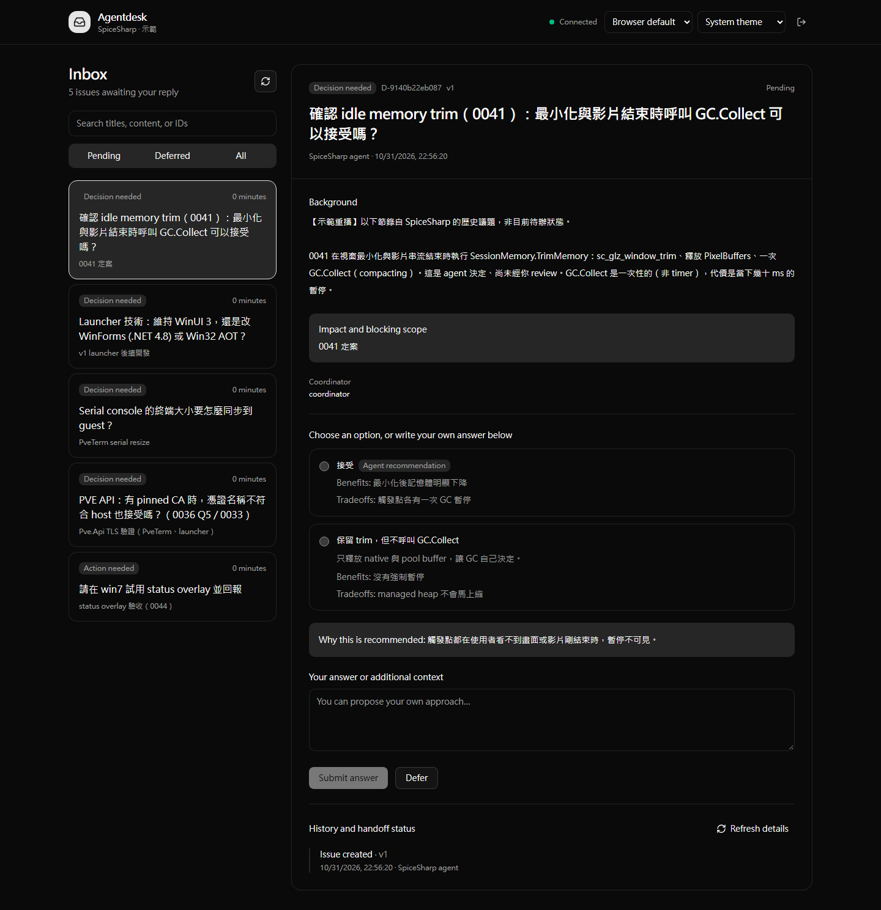
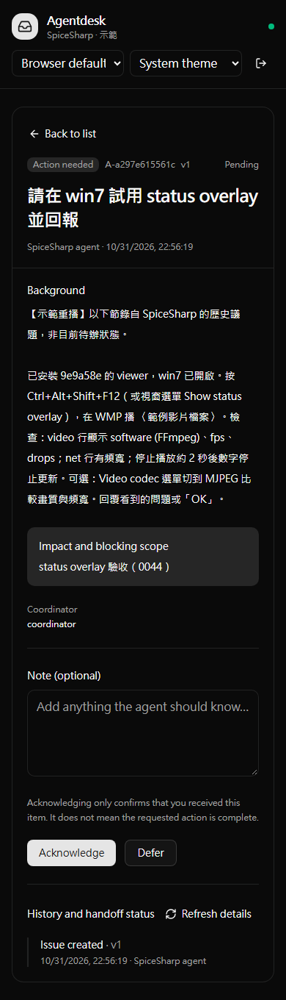

# Agentdesk

English | [繁體中文](README.zh-TW.md)

[](https://github.com/Inndy/agentdesk/actions/workflows/ci.yml)
[](LICENSE)


**100% vibe-coded. Making your vibe coding 100% smoother.**

Let your AI agents send questions to your inbox. Answer in your browser or on your phone, and let the agents get back to work.

Agentdesk is a local inbox for questions that need human input. A single Go executable bundles the CLI, SQLite storage, and Vue web UI on Windows, macOS, and Linux. No Node.js or separate database installation is needed at runtime.



The screenshots replay real historical SpiceSharp issues in an isolated demo project. They do not represent current pending work. Original replies, credentials, and private environment details are excluded.

## Features

| Feature | How it works |
| --- | --- |
| Decisions | Compare options, read the agent's recommendation, or write your own answer. Recommended options are never preselected. |
| Actions and notices | Acknowledge receipt and leave a note. Acknowledgment does not mean the requested work is complete. |
| Defer | Move an issue out of the pending inbox and return to it later. |
| Mobile and dark mode | Responsive UI with system, dark, and light themes. |
| English and Traditional Chinese | Follows your browser language by default. Switch languages at any time; your choice is saved in the browser. |
| Telegram notifications | One message per new issue, with a link containing a one-time login token. |
| Agent handoff | CLI support for background waiting, event recovery, leases, and explicit handoff receipts. |
| Local storage | SQLite stores issues and history. Git worktrees share the same project data. |

<details>
<summary>Mobile demo: responding to an action request</summary>



</details>

## Download a binary

Open [GitHub Actions](https://github.com/Inndy/agentdesk/actions/workflows/ci.yml), select a successful CI run, and download the matching `agentdesk-<platform>-<architecture>` archive under **Artifacts**. Platforms are `windows`, `darwin` (macOS), and `linux`. Choose `amd64` for Intel/AMD or `arm64` for Apple Silicon and other ARM64 systems. Artifact downloads require a GitHub login and are retained for 14 days.

Extract the archive to run the executable. On macOS/Linux, grant execute permission with `chmod +x` first. You can also build from source below.

## Build from source

Requires Go 1.25 or later and [Vite+](https://www.viteplus.dev/) (`vp`). The frontend uses Vue 3, TypeScript, shadcn-vue, and Tailwind CSS.

```sh
vp -C agentdesk-ui install --frozen-lockfile
vp node scripts/build.mjs
```

The output is `bin/agentdesk.exe` on Windows or `bin/agentdesk` on macOS/Linux. The commands below assume the executable is on your PATH; you can also use its full path.

If Make is installed:

```sh
make install
make build
make build-all JOBS=6
```

`build-all` builds the web UI once, then builds six executables in parallel: amd64 and arm64 for all three platforms. The default limit is four concurrent Go builds. All builds use `CGO_ENABLED=0`, with web assets embedded in the executable.

## Quick start

Run these commands in the project you want to use:

```sh
agentdesk start --name my-project --json
agentdesk login --open
```

`start` initializes the project and starts a detached background service. Running it again verifies and reuses the existing service. `login --open` opens your browser to sign in; without `--open`, `login` prints a login URL you can copy.

An agent can create a question from JSON:

```sh
agentdesk create --file examples/decision.json --key choose-first-implementation --json
agentdesk list --pending --json
agentdesk wait D-RETURNED-ID --timeout 50s --json
```

After you answer in the web UI, the agent can retrieve the result with `get`, `wait`, or `inbox`. A timeout never answers on your behalf.

## Install for Claude Code and Codex

```sh
make install-skill
```

The installer places the binary in `~/.local/bin` and installs global skills for both agents, sharing the same executable:

- Claude Code: `~/.claude/skills/agentdesk/`
- Codex: `$CODEX_HOME/skills/agentdesk/` (defaults to `~/.codex/skills/agentdesk/`)

Then invoke `/agentdesk` (or `$agentdesk` in Codex). The skill teaches the agent to ensure the service is running, submit questions, and monitor its own question set using background jobs supported by its host. It checks the monitor whenever work starts or resumes, and keeps monitoring until the goal is complete with no further instructions, or you explicitly ask it to stop.

## Mobile access and Telegram

The first version assumes you manage access to your private network or VPN. The service listens on localhost by default. For phone access, specify a reachable interface and URL, for example:

```sh
agentdesk start --listen 100.100.10.20:7331 --public-url http://100.100.10.20:7331
agentdesk login
```

Copy the login URL to a phone connected to your VPN. Treat the URL as a credential: anyone holding it can sign in.

To enable Telegram, you can reuse an existing configuration file in tg-notify format:

```sh
agentdesk start --telegram --telegram-config /path/to/tg-notify/secrets.json
agentdesk notifications --json
```

The configuration format is `{"bot_token":"…","chat_id":"…"}`. When `--listen` is omitted, Telegram mode detects the local NIC address used by the primary route. Override notification URLs with `--public-url`. The detected address may be a private IP behind NAT; your phone must still be able to reach it.

Notification links contain a one-time login token valid for 24 hours. The URL fragment is cleared immediately after login. The bot only sends notifications; it does not accept Telegram replies or change an existing webhook. Stop an existing service before changing its startup settings.

## Development and CI

```sh
make check
make test
make build
make test-e2e
```

Local E2E tests connect to a dedicated Chrome instance through CDP at `http://127.0.0.1:9222` by default; override it with `AGENTDESK_CDP_URL`. CI automatically uses Playwright headless Chromium. Tests only create temporary projects and interact with localhost.

[GitHub Actions](.github/workflows/ci.yml) runs on pushes to `main`, pull requests, and manual dispatch:

- Vite+ formatting, linting, type checks, unit tests, and web build.
- Native Go vet, tests, and compilation on Windows, macOS, and Linux.
- Parallel binary builds and artifact uploads for amd64/arm64 on all three platforms.
- Headless Chromium end-to-end tests.

CI requires no Telegram credentials. The web UI is built once and shared across subsequent jobs.

## Documentation

The detailed documents below are currently in Traditional Chinese:

- [Operations and data management](docs/OPERATIONS.md): login, VPN, notifications, PID/locks, backups, and coordinator handoff.
- [CLI and HTTP API](docs/API.md)
- [Demo data and screenshot reproduction](docs/DEMO.md)
- [Validation results and limitations](docs/VALIDATION.md)
- [Specification](SPEC.md)

The current focus is the local CLI and web UI. A centralized hub, replies within Telegram, and direct injection into agent sessions are planned for later versions.

## About this project

This project is **100% vibe-coded**: humans define requirements and direction, and AI coding agents implement the software. This describes the development process; it does not imply bug-free code or an independent security audit. Completed tests and unverified environments are listed in the [validation report](docs/VALIDATION.md). Bug reports through [Issues](https://github.com/Inndy/agentdesk/issues) and pull requests are welcome.

Licensed under the [MIT License](LICENSE).
