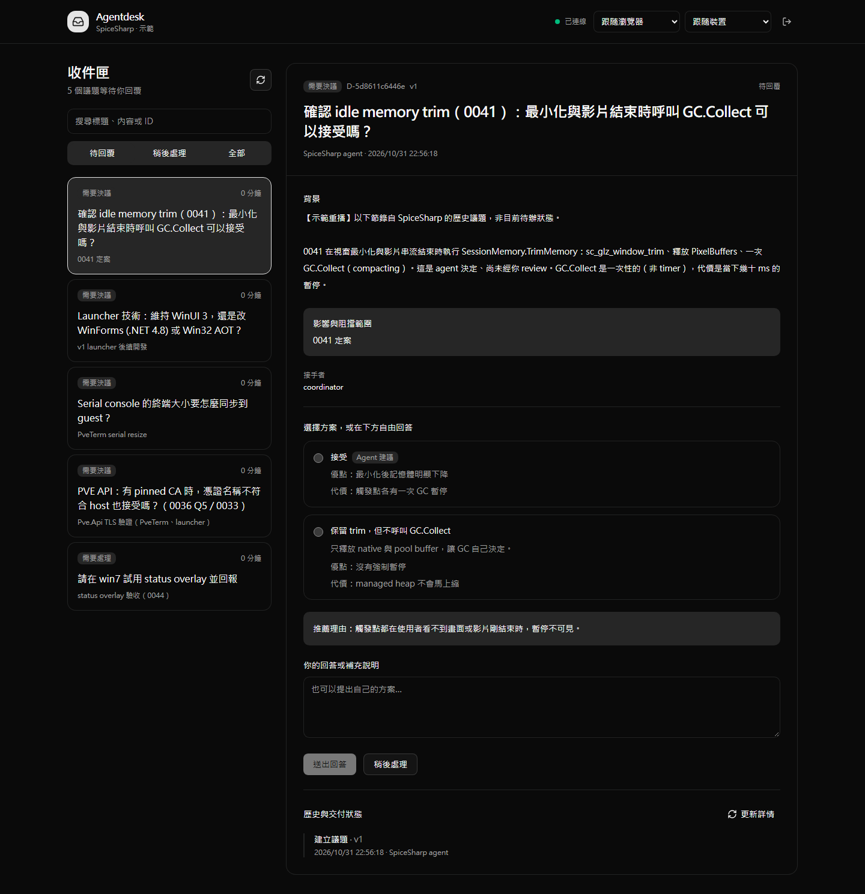
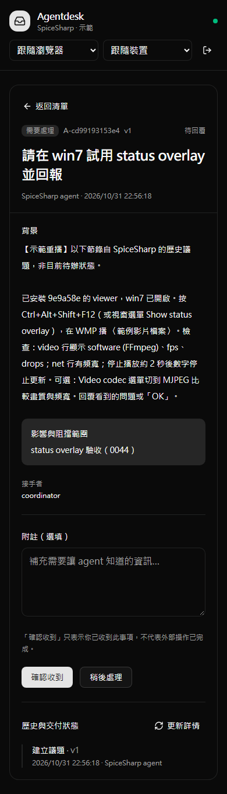

# Agentdesk

[English](README.md) | 繁體中文

[](https://github.com/Inndy/agentdesk/actions/workflows/ci.yml)
[](LICENSE)


**100% vibe-coded. Making your vibe coding 100% smoother.**

讓 AI agent 把問題送到你的收件匣，你在瀏覽器或手機回答，agent 再接著工作。

本機執行的人類議題收件匣。Go 單一執行檔整合 CLI、SQLite 與 Vue Web UI，支援 Windows、macOS、Linux；執行時不需要 Node.js 或另外安裝資料庫。



截圖取自 SpiceSharp 的真實歷史議題，經整理後在獨立示範專案重播，不代表目前待辦。示範不包含原始回答、登入憑證與私人環境資訊。

## 功能

| 功能 | 使用方式 |
| --- | --- |
| 決策問題（Decision） | 比較方案、檢視 agent 建議或自由回答；推薦方案不會預選。 |
| 操作請求（Action）與通知（Notice） | 確認收到並留下附註；Ack 不等於外部工作完成。 |
| 稍後處理 | 先讓問題離開待回覆清單，之後再回來回答。 |
| 手機與深色模式 | 響應式介面，支援跟隨裝置、深色與淺色主題。 |
| 英文與繁體中文 | 預設跟隨瀏覽器語言，可隨時切換並在瀏覽器保存選擇。 |
| Telegram 通知 | 每個新議題一則訊息，連結附一次性登入 token。 |
| Agent 接手 | CLI 支援背景等待、事件補讀、租約與接手 receipt。 |
| 本機保存 | 議題與歷史存入 SQLite，Git worktree 共用專案資料。 |

<details>
<summary>手機版示範：回覆操作請求</summary>



</details>

## 取得執行檔

可到 [GitHub Actions](https://github.com/Inndy/agentdesk/actions/workflows/ci.yml)，選擇成功的 CI 執行紀錄，在 **Artifacts** 下載符合系統的 `agentdesk-<平台>-<架構>` 壓縮檔。平台為 `windows`／`darwin`（macOS）／`linux`；Intel／AMD 選 `amd64`，Apple Silicon 或 ARM64 選 `arm64`。下載 artifacts 需登入 GitHub，保留期限為 14 天。

解壓縮後即可執行；macOS／Linux 請先用 `chmod +x` 賦予執行權限。也可以依下列步驟自行建置。

## 自行建置

需要 Go 1.25 以上與 [Vite+](https://www.viteplus.dev/)（`vp`）。前端使用 Vue 3、TypeScript、shadcn-vue 與 Tailwind CSS。

```sh
vp -C agentdesk-ui install --frozen-lockfile
vp node scripts/build.mjs
```

輸出為 Windows 的 `bin/agentdesk.exe`，或 macOS／Linux 的 `bin/agentdesk`。以下指令假設已將執行檔加入 PATH；也可直接使用完整路徑。

有安裝 Make 時可用：

```sh
make install
make build
make build-all JOBS=6
```

`build-all` 只建置一次 Web，再平行建置三平台各 amd64／arm64 共六個執行檔，預設最多 4 個 Go build。所有建置使用 `CGO_ENABLED=0`，Web 資產內嵌於執行檔。

## 開始使用

在要使用的專案目錄執行：

```sh
agentdesk start --name my-project --json
agentdesk login --open
```

`start` 會初始化專案並在背景啟動服務；再次執行會驗證並重用既有服務。`login --open` 開啟瀏覽器登入；`login` 不帶 `--open` 則輸出可複製的登入網址。

Agent 可以用 JSON 建立問題：

```sh
agentdesk create --file examples/decision.json --key choose-first-implementation --json
agentdesk list --pending --json
agentdesk wait D-RETURNED-ID --timeout 50s --json
```

人類在 Web 回答後，agent 可透過 `get`、`wait` 或 `inbox` 讀取結果。逾時不會自動代答。

## 安裝到 Claude Code 與 Codex

```sh
make install-skill
```

安裝程式將 binary 放到 `~/.local/bin`，並安裝兩份共用同一 binary 的全域 skill：

- Claude Code：`~/.claude/skills/agentdesk/`
- Codex：`$CODEX_HOME/skills/agentdesk/`（預設 `~/.codex/skills/agentdesk/`）

之後輸入 `/agentdesk`（Codex 也可用 `$agentdesk`）。Skill 會教 agent 確認服務已啟動、送出問題，並用宿主可用的背景工作機制持續監看自己的問題集合。每次開始或恢復工作都重新檢查監控；直到目標完成且沒有後續指示，或你明確要求停止。

## 手機與 Telegram

第一版假設你自行連上內網／VPN。預設服務僅監聽 localhost；手機連線需要指定可達的介面與網址，例如：

```sh
agentdesk start --listen 100.100.10.20:7331 --public-url http://100.100.10.20:7331
agentdesk login
```

將登入網址複製到已連上 VPN 的手機。網址具有登入能力，請自行保管。

啟用 Telegram 時，可引用既有 tg-notify 格式的設定檔：

```sh
agentdesk start --telegram --telegram-config /path/to/tg-notify/secrets.json
agentdesk notifications --json
```

設定格式為 `{"bot_token":"…","chat_id":"…"}`。未指定 `--listen` 時，Telegram 模式會偵測主要路由使用的本機網卡位址；`--public-url` 可覆寫通知網址。偵測結果可能是 NAT 後的私有 IP，手機仍須能連到該位址。

通知連結帶有 24 小時有效的一次性登入 token，登入後立即清除 URL fragment。Bot 只發通知，不接收 Telegram 回答，也不更改既有 webhook。更改既有服務的啟動設定前，需先停止該程序。

## 開發與 CI

```sh
make check
make test
make build
make test-e2e
```

本機 E2E 預設連到獨立 Chrome 的 CDP（`http://127.0.0.1:9222`），可用 `AGENTDESK_CDP_URL` 指定。CI 則自動使用 Playwright headless Chromium；測試只建立暫存專案並操作 localhost。

[GitHub Actions](.github/workflows/ci.yml) 在 push 到 `main`、pull request 或手動觸發時執行：

- Vite+ 格式、lint、型別檢查、單元測試與 Web 建置。
- Windows、macOS、Linux 原生 Go vet、測試與編譯。
- 三平台各 amd64／arm64 執行檔平行建置並上傳 artifact。
- Headless Chromium 端到端測試。

CI 不需要 Telegram 憑證；Web 只建置一次，後續工作共用同一份資產。

## 文件

- [操作與資料管理](docs/OPERATIONS.md)：登入、VPN、通知、PID／鎖、資料備份與 coordinator 接手。
- [CLI／HTTP API](docs/API.md)
- [示範資料與截圖重建](docs/DEMO.md)
- [驗證紀錄與限制](docs/VALIDATION.md)
- [需求規格](SPEC.md)

目前聚焦本機 CLI 與 Web。集中式 Hub、在 Telegram 內回答，以及直接注入 agent session 留待後續版本。

## 關於這個專案

這是 **100% vibe-coded** 的專案：由人類提出需求、決定方向，透過 AI coding agents 開發。這項聲明描述開發方式，不代表程式碼沒有 bug 或已完成獨立安全稽核；已執行的測試與尚未驗證的環境列在[驗證紀錄](docs/VALIDATION.md)。歡迎透過 [Issues](https://github.com/Inndy/agentdesk/issues) 回報問題，或提交 Pull Request。

採用 [MIT License](LICENSE)。
